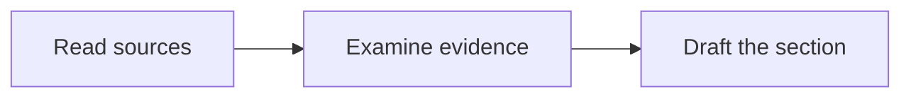

# Markdown, Diagrams, and Native Word Equations

Apply this contract to maintained Markdown, adopted manuscripts, and derived document extractions. Preserve received originals and parser-native results. Normalize derived syntax only when its meaning is preserved; flag uncertain formulas instead of guessing them.

## Mathematics in Markdown

Use `$...$` for inline mathematics and `$$` on separate lines for display mathematics. Keep blank lines outside display blocks and no blank lines inside them. For example, write inline syntax as `$y = \alpha x + \beta$`.

A display example:

$$
\hat{\mu} = \frac{1}{n}\sum_{i=1}^{n} x_i
$$

GitHub documents these delimiters and its MathJax renderer in [Writing mathematical expressions](https://docs.github.com/en/get-started/writing-on-github/working-with-advanced-formatting/writing-mathematical-expressions). Use commands that the target renderer supports. Full LaTeX packages and arbitrary custom macros are not the workspace's default math interface. Do not replace editable formula source with a screenshot. Keep literal currency symbols distinct from math delimiters using the documented context-specific syntax.

GitHub also documents alternative inline delimiters and `math` fences. The workspace defaults above keep one common form for export. An importer must preserve or safely normalize supported alternatives, not nest math delimiters inside a math fence. Equation labels follow the next section; a LaTeX-only `\label{}` or `\tag{}` is not part of the workspace syntax.

## Citations and cross-references

Outputs are built with Pandoc, pandoc-crossref, and citeproc; the agent writes and maintains this syntax.

- **Citations:** `[@key]` in parentheses, `@key` in running text, `[@key, p. 12]` with a locator, `[@key1; @key2]` for several, and `[-@key]` without the author name. Keys come from `references/bibliography.bib`. A key that does not resolve is a build failure, and a key that resolves is still not evidence of support.
- **Figures:** `{#fig:id}`; the text refers to `@fig:id`.
- **Tables:** a caption line after the table, `: Caption {#tbl:id}`; the text refers to `@tbl:id`.
- **Equations:** a display block, then a blank line, then a paragraph that holds only the label:

  ```text
  $$
  \hat{\mu} = \frac{1}{n}\sum_{i=1}^{n} x_i
  $$

  {#eq:mean}
  ```

  The text refers to `@eq:mean`. Never write the label on the closing `$$` line or on the line after it without a blank line: GitHub then shows the equation as plain text. The export attaches the label with the project filter `scripts/export/equation-labels.lua`.
- **Sections:** a heading is referred to by its automatic identifier, `@sec:<identifier>`, which Pandoc derives from the heading text (lowercase, spaces become hyphens, leading numbers and punctuation dropped; Chinese characters are kept, as in `@sec:研究方法`). Add an explicit `{#sec:id}` to a heading only when a reference must survive a change of the heading text.
- **Diagram figures:** a Mermaid block that should be a numbered figure is followed by a blank line and a caption paragraph, `: Caption {#fig:id}`, the same form as a table caption. GitHub renders the block as a diagram and shows the caption line as text; the export renders the diagram as a figure with that caption and label.
- **Open items:** a claim that still needs evidence, or any other unfinished point, is marked in the text as `[TODO: ...]`, described in the manuscript language. `python scripts/manuscript.py check` lists every marker, and no package is reported ready while one remains.
- **Identifiers and numbers:** labels use lowercase letters, digits, and hyphens after the prefix, and are unique per kind. Never number figures, tables, equations, sections, or citations by hand. The words in front of a number (“Figure”, “Eq.”, “图”) come from the output profile, so write `@fig:id`, not “Figure @fig:id”.
- **No LaTeX commands in the text:** Pandoc reads a LaTeX command outside math and code, such as `\cite{key}`, `\ref{fig:id}`, `\textbf{word}`, or `\begin{itemize}`, as raw LaTeX and drops it from the Word file without an error; with Pandoc 3.12.1, “See \cite{key}” became “See”. Write the Markdown form instead (`[@key]`, `@fig:id`, `**word**`, a Markdown list), and put a path or code in backticks. Backslash escapes such as `\%`, `\_`, `\&`, and `\$` are not commands and stay valid. `python scripts/manuscript.py check` reports each command as a problem, with the form to use.
- **Punctuation in Chinese and Japanese text:** full-width marks (，。；：！？, and 、 in Japanese) are the usual form. The check warns about a half-width mark directly after Chinese or Japanese text, outside citation keys and cross-references; a confirmed rule or the venue's style can keep half-width marks.

On GitHub, `{#fig:id}`, the table caption line, and the `{#eq:id}` paragraph show as text, and `@fig`, `@eq`, `@tbl`, or `@sec` can show as links to GitHub users of those names. These effects touch only the GitHub preview; the export resolves every reference, and an unresolved label is a build failure.

## Mermaid explanation diagrams

Use fenced `mermaid` blocks for agent-created explanation diagrams, such as workflows, concept relationships, and system structures. Keep labels in the document's chosen language. For example:



Use a conservative syntax supported by the target GitHub Mermaid version. The GitHub [diagram guide](https://docs.github.com/en/get-started/writing-on-github/working-with-advanced-formatting/creating-diagrams) documents the fence and an `info` diagnostic for the active version. Do not assume the latest upstream feature is available on GitHub.

Prefer simple node identifiers and quoted labels. Follow the official [flowchart syntax](https://mermaid.js.org/syntax/flowchart.html) for Unicode, punctuation, reserved words, and diagram-specific rules. Complex HTML labels, external fonts/icons, and experimental configuration require target-renderer verification. Keep complex formulas outside diagram labels when necessary for reliable rendering and native Word math.

Scientific result plots, measurements, photographs, and source-document images retain their appropriate plotting or original formats. Mermaid does not replace them. A diagram's arrows must represent the intended relationships without inventing scientific causality.

## Publication output

Keep an identifiable, editable Mermaid source for each diagram: its designated Markdown block or an identified asset source. Generated image copies are derived artifacts, not a second independently maintained diagram. For Word, LaTeX, or PDF, render Mermaid into suitable figure assets and inspect labels, arrows, clipping, fonts, and readability at the actual output size. Preserve captions and cross-reference identities. A raw code block or an empty placeholder is not a completed figure.

### Word mathematics must be native and editable

Authored manuscript formulas in DOCX must become native Office Math objects, stored as OMML. Microsoft describes this format in its [math documentation](https://learn.microsoft.com/en-us/office/math/). Preserve inline versus display placement and the actual mathematical structure. The XML structure uses `m:oMath` and, for display math, an appropriate `m:oMathPara` container; validate the generated structure against the applicable Word format.

Images, plain text, unconverted LaTeX strings, and legacy embedded equation objects do not satisfy this native-equation requirement. Putting an unparsed LaTeX string inside an OMML text node also does not pass. Preserve fractions, scripts, operators, limits, accents, matrices, alignment, and symbols. Handle numbering, captions, and cross-references through the adopted profile without changing mathematical meaning.

The [Pandoc math documentation](https://pandoc.org/MANUAL.html#math) describes OMML output for DOCX. Check the actual source-to-output mapping and the rendered result for each manuscript.

If a formula cannot be converted faithfully, identify its source location and the failed construct. Preserve the original and mark the affected output requirement unmet. Do not silently fall back to an image, plain text, or a changed formula and report success. An equation available only as an imported image needs checked transcription before it can satisfy native-equation export.

## Verification contract

1. Inspect Markdown structure, delimiters, math commands, Mermaid fences, and diagram syntax with appropriate parsers. Do not treat regular expressions or balanced delimiters as proof of correct rendering.
2. Render representative inline/display formulas and diagrams with the actual target or a documented compatible renderer. Inspect Unicode, special characters, multiline structures, long labels, and layout. Record renderer/version and limitations. Local success alone does not establish GitHub success; validate actual GitHub behavior with permitted material when claiming that integration. User data must not be published or sent to a new external preview service merely to test rendering.
3. For DOCX, inspect the relevant XML parts with namespace-aware checks. Reconcile each expected source formula with native math content; counting one math element is insufficient, including when a template already contains equations. Check mathematical structure and conversion diagnostics, not just the presence of OMML tags.
4. Inspect the actual Word layout and representative editing of native formulas where Word verification is available. Cover inline/display math, fractions, scripts, matrices, multiline alignment, tables/captions as used, numbering, and cross-references. Report the actual inspection application and scope; another viewer alone does not establish tested Word behavior.
5. Rebuild after a formula or diagram changes and invalidate affected prior checks. Keep unsupported cases visible and preserve earlier releases. A generic successful export is not evidence that all equations and diagrams meet this contract.

Run `scripts/manuscript.py check` for source conventions and `scripts/export.py build` for source-to-output equations, figures, references, citations, and layout expectations. Inspect the actual rendered pages through the submission assembly task. Researchers request the outcome in natural language; the assistant maintains syntax, tools, assets, and checks. Add no compulsory graphics runtime merely to initialize or read the workspace.
