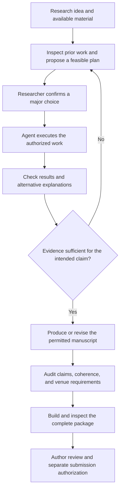

# Research Workflow Review and Public Knowledge Transfer

Status: design review. The core end-to-end objective is confirmed for framework testing only; detailed operating-model changes remain proposals.
Reviewed: 2026-10-26 against design plan v0.9 and the actual repository.

The researcher's clarified role is confirmed: direct the ideas and scholarly expression, make consequential judgments, and review final work. The agent carries feasible authorized production and coordination. The implementation changes below remain proposals requiring the maintainer's confirmation.

The maintainer accepted the complete-path objective specifically as a test. Its bounded example must not become a product scope limit, mandatory researcher workflow, or a claim that real submission readiness has been demonstrated.

## 1. Assessment

The current design is a strong foundation for organizing and developing a paper. It covers intake, references, evidence notes, confirmed requirements, writing, feedback, major revision, rendering, and version recovery. It does not yet specify a complete research-production contract, and no working skills or pipelines exist in the repository.

The main gap is between an approved research plan and checked research findings. Creating a code directory, finding papers, or drafting fluent prose cannot establish that this gap has been closed. MVP 4 currently verifies code setup with a small smoke task; it does not demonstrate a complete analysis. MVP 9 proposes an end-to-end exercise, but it needs explicit research-execution and researcher-effort criteria.

Do not require the researcher to arrive with cleaned data, final figures, or completed findings. Where feasible and authorized, the agent should obtain accessible material and perform the preparation itself.

The target should be a researcher-directed production process whose intermediate outputs are inspectable and whose final package meets a selected venue's applicable requirements. Submission readiness, successful file generation, author approval, and journal acceptance remain separate outcomes.

A clean-data computational paper can benefit from extensive agent execution. Literature, theoretical, and interpretive work needs its own evidence and argument checks. A study requiring new physical observations may need a laboratory or other external contribution. These are capability and dependency differences, not discipline-based admission rules.

## 2. What public OpenAI work actually transfers

The detailed source registers are [scientific cases and artifacts](openai-science-source-notes.md) and [agent engineering and submission sources](agent-workflow-source-notes.md). They distinguish direct evidence, design inference, publication status, and unavailable evidence. They do not claim access to an unpublished internal playbook.

| Public evidence | Reusable lesson for this workspace |
| --- | --- |
| The [OpenAI math collection](https://github.com/openai/math) separates manuscripts, proof artifacts, citation/build information, and verification stages; its [history](https://github.com/openai/math/blob/main/history.md) propagates corrections to dependent work. | Preserve result dependencies, validation status, versioned artifacts, and downstream correction obligations. A manuscript collection is not a journal-acceptance record. |
| The [scientific-computing field report](https://cdn.openai.com/pdf/scientific-computing-in-the-age-of-agentic-ai-an-exploratory-field-report.pdf) describes agents doing implementation while researchers specify tasks and judge validity. | Transfer implementation and routine comparison to agents; make scientific checks and outputs observable. Treat exploratory case reports as evidence of methods, not universal productivity estimates. |
| The [Jang–Ryu paper v2](https://arxiv.org/html/2510.23513v2) corrects an insufficiently checked subsidiary result; [First Proof](https://openai.com/index/first-proof-submissions/) also records a changed correctness judgment. | Verify secondary claims and extensions as well as the main result. A fresh model review can help, but agreement alone is not external verification. |
| The [distributed-agent research repository](https://github.com/jinlabneurogenomics/distributed_agent) preserves model outputs separately from deterministic tables and figure analysis. | Save expensive outputs and rebuild downstream products without repeating model calls. Large published workloads are examples to scale down, not default laptop dependencies. |
| The [autonomous-lab manuscript](https://cdn.openai.com/pdf/5a12a3bc-96b7-4e07-9386-db6ee5bb2ed9/using-a-gpt-5-driven-autonomous-lab-to-optimize-the-cost-and-titer-of-cell-free-protein-synthesis.pdf) relies on actual lab interfaces and physical execution. | Distinguish proposed work, executed work, observations, and supported conclusions. The template cannot replace unavailable physical research with text. |
| OpenAI's [harness engineering account](https://openai.com/index/harness-engineering/) and [execution-plan pattern](https://developers.openai.com/cookbook/articles/codex_exec_plans) use repository-visible instructions, work state, and observable completion. | Make the next task and evidence available across sessions. Adapt software practices to science; do not import autonomous decision rules over this project's confirmation requirement. |

This is an evidence-based transfer of operating methods. It does not transfer an unreleased model, undisclosed orchestration, laboratory access, compute allocation, or validated scientific results into a clone of this repository.

## 3. Gaps and concrete proposed changes

| Priority | Current coverage and gap | Proposed agent-owned outcome |
| --- | --- | --- |
| P0: execution | Research planning and bounded investigation exist; code setup is explicit, but production of checked research outputs is not sufficiently specified. | Execute an authorized, feasible inquiry: obtain material, inspect quality, implement the method, run it, resolve routine failures, and deliver actual results with their provenance. Adapt to computational, documentary, theoretical, or interpretive work. |
| P0: results and claims | Literature provenance is strong; ownership and representation of this project's own results are underspecified. | A compact result record connects inputs, method/code or argument, parameters, run/version, output, checks, limitations, and dependent manuscript claims. Distinguish external literature, project observations, interpretation, and hypotheses. |
| P0: verification | Manuscript audit and stale-check handling exist; scientific verification needs explicit methods and outputs. | Use suitable reference results, reproduction, sensitivity checks, counterexamples, source comparisons, or proof obligations. Record actual checks and failures. Do not use an agent self-score or two models agreeing as proof. |
| P0: orchestration | The hands-on guides select skills; a single objective still needs an explicit execution/completion contract. | After the necessary major choices, carry routine work through to the requested artifact, maintain progress, resume failures, and select the next useful task without asking the researcher to dispatch each stage. |
| P0: venue-compatible package | Formatting and readiness are well covered; applicable non-manuscript files, factual declarations, and early AI-policy routing need stronger coverage. | Derive the complete deliverable list from the actual venue/article type, prepare allowed material, collect only genuinely missing author facts, and report each requirement's artifact or blocker. |
| P0: researcher effort | Technical-file editing is prohibited for ordinary use; avoidable coordination and clerical effort are not explicit acceptance measures. | Record manual technical actions, material copying, avoidable questions, and clerical time separately from scientific review. Fix the cause of work being sent back to the researcher. |
| P1: resources and scope | The Windows baseline and optional environments are defined; research execution still needs per-task capability bounds. | Use small local tasks by default, cache outputs, constrain concurrency, inspect data/runtime needs, and obtain confirmation for a new service, material scope, or consequential cost. Report unavailable capability accurately. |

Do not solve these gaps merely by adding more directory names or skill titles. Define inputs, owned outputs, checks, recovery, and handoffs first. Reuse `state/current.md`, existing work records, `research/`, `code/`, source notes, and release manifests where appropriate. The exact storage of research inputs, runs, and results remains an implementation decision; no new directory tree is adopted here.

## 4. Proposed operating loop

The diagram summarizes a proposed process, not a rigid course or a claim of implemented rendering. Later major choices still need confirmation. Initial permission does not authorize an unlimited change of method, claim, service, or spending. Routine implementation within confirmed scope continues without repeated approval.

1. **Create a useful project brief.** Extract the question, motivation, available material, intended contribution, language, audience, constraints, and current target from what is already available. Ask only for missing judgments. Unknown venue or methods can remain open until needed.
2. **Prepare a defensible plan.** Compare close prior work, identify alternatives and counterevidence, propose a feasible method and what would establish or weaken the intended claim. Inspect the resources needed. Present one consequential choice at a time, with a recommendation and its effect.
3. **Execute the approved inquiry.** Perform permitted acquisition, material organization, data-quality inspection, analysis, coding, symbolic work, or documentary comparison as appropriate. Preserve raw inputs and record transformations. Investigate routine failures before asking for help. Physical experiments, inaccessible material, and institution-only actions become specific external dependencies with a prepared next step.
4. **Deliver and verify results.** Save outputs that can be inspected or reproduced. Keep proposed, attempted, observed, checked, and author-approved states distinct. Test suitable baselines and alternative explanations. Retain negative or failed results relevant to the conclusion; do not select an attractive narrative and manufacture support.
5. **Maintain the claim-to-evidence chain.** Link important claims to literature locations or project results, and link results to their inputs and checks. Keep a lightweight representation rather than requiring a metadata file for every sentence. A changed upstream result invalidates affected figures, tables, prose, summaries, and readiness checks.
6. **Produce the paper in its permitted writing mode.** The agent carries the drafting and revision work allowed by the selected venue and the researcher's instructions. It edits the project directly, maintains citations and exhibits, reconciles feedback, and returns a coherent manuscript. Missing evidence stays explicit. The researcher reviews scientific meaning and final expression rather than assembling the text by hand.
7. **Prepare the actual submission package.** Assemble the required files, figures, supplements, cover letter or other accompanying material, metadata, applicable reporting items, and factual statements. Check GitHub math/Mermaid sources, native Word equations, the actual rendered output, and package completeness. Human-only declarations and coauthor approvals must be real. Prepare portal entries if specifically authorized and feasible; upload or final submission remains a separate scoped action.
8. **Return a short author-facing review.** State what was completed, what supports the result, what failed or remains uncertain, and which decision is needed. Keep detailed logs and technical records available without making the researcher read them to continue. Resume future sessions from maintained state, not from the researcher's reconstruction of prior work.

## 5. Venue policy is an input to production

Permitted assistance is not universal. The current [Taylor & Francis guidance](https://authorservices.taylorandfrancis.com/editorial-policies/using-ai-in-your-research-and-manuscript-preparations/) restricts first-draft generation and describes permitted assistance and disclosure. Check the actual target before substantive drafting and again before submission; a disclosure cannot make a prohibited workflow acceptable. If full agent drafting is essential, explain this constraint when comparing targets. Do not relabel generated argument as copyediting.

The [PLOS One submission instructions](https://journals.plos.org/plosone/s/submission-guidelines) illustrate why a paper file alone is insufficient: the submission also has accompanying material and author information. Use the actual target's list, not PLOS's article structure as a universal template.

The agent should prepare factual declarations from confirmed information and keep a minimal record of actual AI assistance for applicable disclosure. It must not invent author contributions, agreement, consent, approvals, funding, conflicts, data availability, or research that did not occur. This is preparation for real submission, not a new generic compliance questionnaire imposed on every project.

## 6. Skill changes proposed for approval

Keep the existing 33-skill catalog for now. The following changes concern outcomes, not a new collection of names:

| Existing skill or group | Proposed strengthened contract |
| --- | --- |
| `project-onboarding`, `research-planning` | Produce the brief and executable research plan with explicit decisions, resource needs, and observable success criteria. |
| `research-investigation`, optional `research-code-setup` | Carry an authorized research task to actual material/analysis/proof artifacts and results; setup alone does not satisfy execution. |
| `literature-and-evidence`, `manuscript-audit` | Verify source support and project-result dependencies, check relevant secondary claims, and return prioritized actionable findings. |
| `manuscript-writing`, `manuscript-revision` | Deliver the complete requested manuscript or revision within confirmed scope and applicable AI policy, with the agent doing the production work. |
| `submission-assembly`, `submission-readiness` | Build the full applicable package and assess scientific, policy, document, package, and author-review requirements separately. |
| `paper-hands-on` | Coordinate execution toward the researcher's outcome. Teaching is optional; the researcher does not manually operate each stage. |

A separate result-verification or research-execution skill may be justified later by real task boundaries. Do not add one solely to make the catalog look complete. A single agent with separate work/check phases can be a baseline; extra agents are optional and do not replace external checks.

## 7. Confirmed test objective and proposed test procedure

Confirmed test objective: exercise a complete **idea/materials → actual results → supported manuscript → checked submission package** path using a bounded case. Accessible material or existing data keeps the test controllable; it does not limit the framework to those inputs, a particular discipline, a small project, or one study type. It is a test of integration and researcher effort, not a product definition or a promise of publication.

The existing nine-MVP roadmap remains planned. This confirmation does not reorder the roadmap, narrow the first release, or adopt every implementation recommendation in this review. The detailed fixture, tools, resource envelope, and appropriate checks still need to be specified when preparing the test. Recovery is part of the tested path.

Suggested test coverage uses two bounded, rights-cleared scenarios: one with existing data and a reproducible analysis, and one literature/documentary or conceptual task. These are coverage examples, not supported-research allowlists. Include a source contradiction, an unsupported secondary claim, interrupted execution, a fresh session, a concurrent author edit, and a consequential revision. Use known expected outputs to test the process; label synthetic examples and test packages clearly and do not call a test manuscript a new publishable discovery.

Pass criteria:

- The researcher supplies ideas, genuine inputs, relevant domain judgments, major choices, and final review. No manual BibTeX/YAML/environment/Git/script work or copying of intermediate artifacts is required.
- Agent execution produces inspectable results, accurate citations, coherent text, suitable figures, and a package tied to current checks. Actual research gaps remain blockers to readiness.
- A separate verification pass finds the planted defects using evidence or executable checks, rather than a favorable self-assessment. Correction updates the dependent manuscript and package.
- Failure, session change, and revision do not lose work or make the researcher rebuild the task history. Required human decisions are asked clearly without repeated routine permission requests.
- Record scientific review time separately from clerical effort, avoidable questions, manual technical actions, runtime, and service use where observable. Do not invent a universal time saving or success rate.
- Declare the exact tested hardware, OS/architecture, services, data size, and export scope. A Mac demonstration is not proof of Surface or ARM64 support. Submission readiness is claimed only when the actual applicable blockers are resolved.
- Keep test assertions separate from real manuscript readiness. A negative case can pass its test by correctly reporting a blocker. A successful test package does not establish novelty, real author approval, journal acceptance, or untested format/platform coverage.
- At least one positive case must complete the full path and produce the expected linked results and package. Correctly reporting a blocker in a negative case tests failure handling; it cannot replace a successful complete-path demonstration.

The core test objective no longer awaits confirmation. No test has been executed and no real journal submission is required by this decision. Report future test evidence as such; keep the general framework open to other materials, scales, methods, and external research dependencies without inventing capabilities that have not been implemented or verified.
