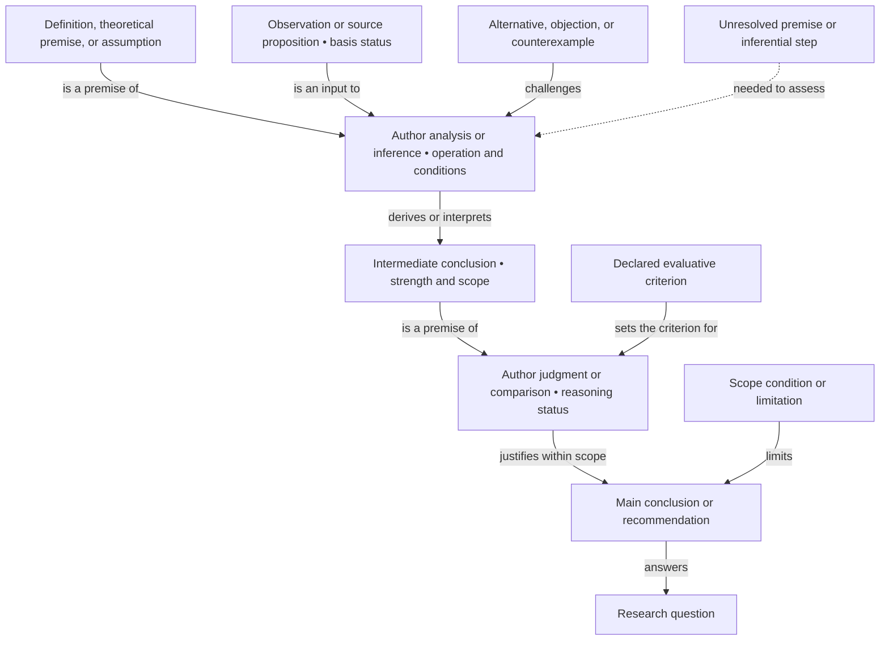

# Manuscript Argument and Logic Map

Internal authoring reference. Follow the [logic map guide](../docs/logic-map-guide.md). Keep this file and its synchronization record outside the assembly manifest and publication output.

No manuscript logic map yet. Replace this scaffold with the actual planned or written argument. These nodes are placeholders, not findings or reviewed reasoning.

## Reasoning register

Use the graph's IDs. Record only material steps needed to inspect the argument, with links to existing sources or derivations.

| ID | Premises and basis | Analysis, inference rule, or criterion | Conclusion and conditions | Draft location / supporting record | Review and author status |
| --- | --- | --- | --- | --- | --- |
| R1 | Replace with the actual premises | Replace with the author's stated operation or warrant | Replace with the derived claim and its scope | Link the relevant passage and records | Unreviewed scaffold |
