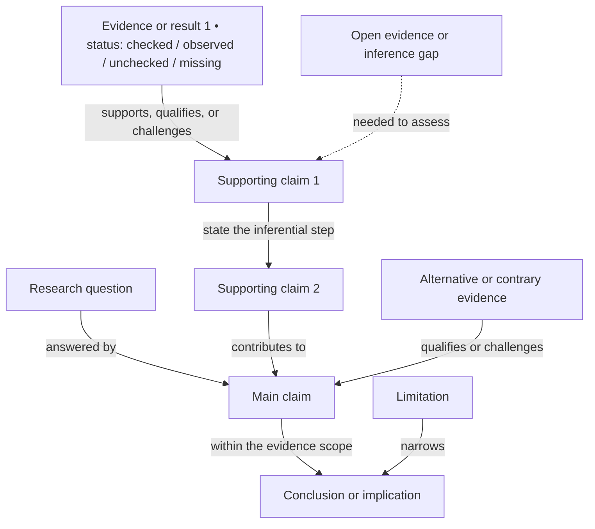

# Manuscript Logic Map

Internal authoring reference. This Mermaid map is not manuscript body text and must never be listed in `manifest.yaml` or included in a publication output.

Follow the [internal logic map guide](../docs/logic-map-guide.md) when building or reviewing this file.

No manuscript logic map yet. Replace this scaffold after the paper's argument and structure are confirmed, or after an imported draft is adopted. The nodes below are placeholders, not claims about this paper.

