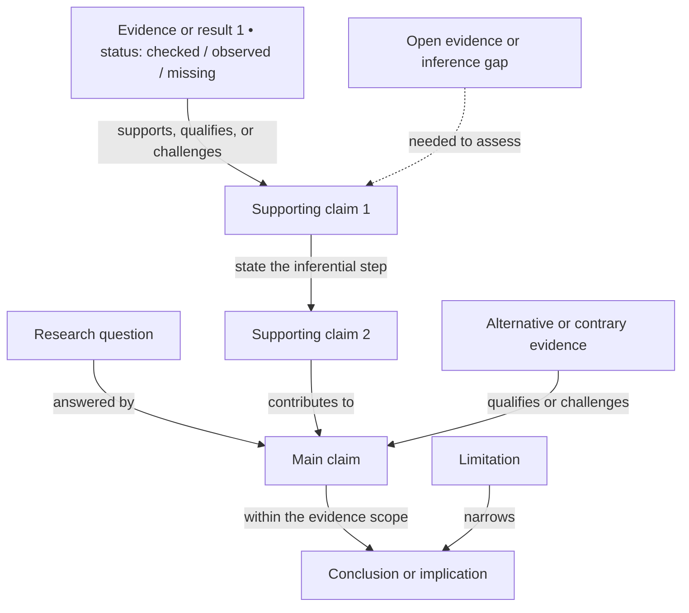

# Manuscript Logic Map

Internal authoring reference. This Mermaid map is not manuscript body text and must never be listed in `manifest.yaml` or included in a publication output.

No manuscript logic map yet. Replace this scaffold after the paper's argument and structure are confirmed, or after an imported draft is adopted. The nodes below are placeholders, not claims about this paper.

Replace each multi-option edge label with the actual relationship and explain each inferential step in a short edge label. Group claims by the paper's real sections when that improves the view. If a single graph becomes hard to read, keep this paper-level flowchart and add a focused local flowchart below for the section that needs it. Do not force a fixed article structure.

Arrows show support, inference, qualification, challenge, or another stated logical relation, not manuscript reading order. Use dashed arrows only for an explicit gap and label what evidence or reasoning is needed; do not make a gap look like support.

For imported text, map what the draft states and mark source support as unchecked until it has been checked against an archived original or a checked result. The map exposes reasoning and evidence gaps; it does not prove that a claim is true.
